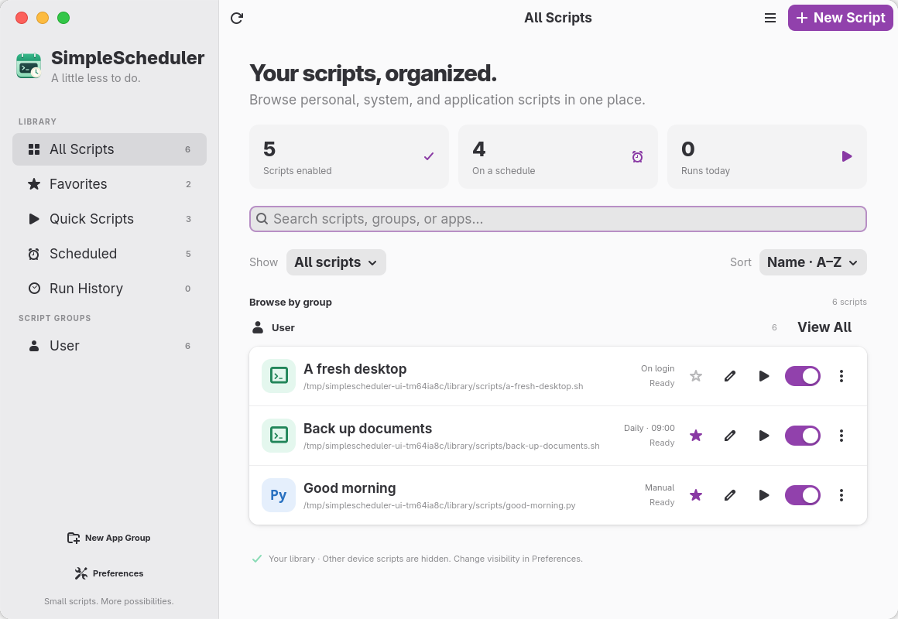

# SimpleScheduler

A little less to do. A native GNOME home for your Linux scripts and routines, built with Python, GTK 4, libadwaita, and GtkSourceView.



## Run

```bash
./run.sh
```

Requires Python 3.10+, PyGObject, GTK 4.10+, libadwaita 1.5+, GtkSourceView 5, and systemd with a user session. No pip packages or network services are needed. The required libraries are already installed on the development device.

Fedora:

```bash
sudo dnf install python3-gobject gtk4 libadwaita gtksourceview5
```

Ubuntu 24.04 or later:

```bash
sudo apt install python3-gi python3-gi-cairo gir1.2-gtk-4.0 gir1.2-adw-1 gir1.2-gtksource-5
```

## Install in the GNOME application grid

```bash
make install
```

This installs the app, desktop entry, AppStream metadata, and icons to `~/.local`. Launch **SimpleScheduler** from the application grid, or run `~/.local/bin/simple-scheduler`. Installation never enables a script. `make install PREFIX=/another/location` supports other installation prefixes.

Install before setting up long-lived schedules. A schedule points to the runner that created it: a schedule created from the checkout needs that checkout to stay in place. Re-save existing schedules from the installed app to use the installed runner.

`make uninstall` removes the application while keeping your script library and history. Disable scheduled scripts before uninstalling; the uninstaller checks for active schedules.

## What it does

- **Discover:** finds readable shell, Python, JavaScript, Ruby, Perl, and extensionless shebang scripts. Watches folders for new, renamed, or removed files. A periodic scan catches changes beyond the native monitor limit.
- **Organize:** browse User, System, Kernel, Operating System, and Applications. App groups use installed desktop names and icons, and recognize project folders. Search by a script’s name, path, language, or group. All Scripts shows a short preview of each group with a View All button.
- **Favorites and Quick Scripts:** star scripts to keep them in Favorites. Turn on **Quick Scripts** in a script’s Organization settings to pin a run card, then run or stop it directly from the Quick Scripts page.
- **Create and edit:** a native dialog with language templates, line numbers, syntax highlighting, dark-mode styles, and unsaved-change protection. Imported files stay in their original locations.
- **Manage:** enable or disable scripts, run now, stop a running script, open its folder, or remove it from the library. Removing a script keeps the file and suppresses future discovery until you import it again.
- **Schedule:** run manually, on graphical login, at system startup, hourly, daily, weekly on Mondays, or at an interval from 1 minute to 7 days.
- **Inspect:** see recent runs, exit status, and live combined stdout/stderr. Run output is capped at 2 MiB per run. Simultaneous runs of the same script are prevented.
- **Feel at home:** follows the desktop accent color and light/dark preference, uses native dialogs and keyboard shortcuts, and collapses the sidebar in smaller windows.

## Everyday shortcuts

Click a script row once to open its details, or click its pencil to open the editor directly. Keyboard activation with Enter still works. The row’s menu, also available on right-click, includes Edit, Duplicate, favorite/pin controls, Copy File Path, Open Containing Folder, recent output, and removal. Quick Script cards also have an Edit button.

Import multiple files at once with **Import Scripts**, or drop script files onto the app. Valid scripts are imported even if another file in the batch is unsupported; existing entries retain their identities and settings. You can undo a library removal from the confirmation toast, restoring the previous entry, history, favorites, pins, and schedule.

Search words can match different fields: for example, `backup python` matches a backup script written in Python. Press Enter in search to open the first result, or Escape to clear the query. Filter by Enabled, Disabled, Running, or Needs attention; sort by name, date added, last run, or favorites. Sort order is remembered, and live updates preserve the current scroll position. Empty filtered views offer Clear Filters.

In the editor, **Ctrl+S** saves without closing, **Ctrl+F** opens Find, Enter/Shift+Enter moves between matches, and **Ctrl+W** closes with unsaved-change protection. **Ctrl+Enter** runs the saved script, or stops it when it’s already running. Unsaved drafts must be saved before they can run. The editor shows line/column position and save state, supports horizontal scrolling, and detects external edits before replacing a file. Duplicating creates a new manual script and preserves interpreter-sensitive extensions such as `.mjs`, `.zsh`, and `.fish`.

Schedule changes get a fixed Save/Reset bar. Leaving the script or closing the app prompts to save, discard, or keep editing. Saving an edited name cannot overwrite a schedule changed elsewhere. Closing the app also protects unsaved editor drafts.

Run completion toasts link directly to output. The output dialog shows duration, follows new output while you’re at the bottom, lets you scroll back without being pulled down, and can copy or export the log. Dark mode keeps script icons and success statuses readable.

## Script groups

The library defaults to scripts you created, imported, explicitly added, or already configured. Automatically discovered scripts and missing files are hidden by default. In **Preferences → Library visibility**, enable **Show discovered scripts** to browse the device inventory, and **Show missing scripts** to see entries whose files are gone. These preferences apply to library pages, search, groups, counts, Favorites, and Quick Scripts. Run history is retained.

When browsing discovered scripts, **Add to Library**, favoriting, pinning, enabling, or configuring a script keeps it in your personal library. Unstarring or unpinning does not remove it from the library. Importing an already discovered file adds that existing entry instead of creating a duplicate.

Scripts are automatically organized using file locations and installed desktop metadata:

| Group | Includes |
| --- | --- |
| User | Personal scripts, including scripts created in SimpleScheduler |
| System | Local administration scripts, `/usr/local` tools, and `/etc` helpers |
| Kernel | Kernel module, initramfs, and boot-image tools such as akmods and dracut |
| Operating System | Distribution-provided scripts under standard OS directories |
| Applications | Installed apps and projects, including their scripts and helpers |

App-specific groups appear under **By Application** in the sidebar. For example, the installed IdeaPad Control Center is named **Singularity Control Center**, so its project and helper scripts use that name and its installed icon. Development folders such as `Repos` and `Projects_Linux` are grouped by project; extracted app folders can be recognized from their installed app names.

Grouping is a local heuristic, not a package ownership audit. Open a script’s **Organization → Group** setting to override its group, or select **Automatic** to restore detection. **New App Group** creates a custom group and can match an entire folder, including future scripts. A selected group folder is added to discovery locations when needed. Group assignments never change whether a script is enabled or when it runs.

## Discovery scope

Defaults include your home folder, `~/.local/bin`, the managed script folder, `/usr/bin`, `/usr/sbin`, `/usr/local/bin`, `/usr/local/sbin`, `/opt`, and the standard `/etc/cron.*` script folders. Add or remove discovery locations in **Preferences**. Files outside those locations, files you cannot read, and scripts inside skipped dependencies are not listed. Virtual filesystems, directory symlink loops, caches, `node_modules`, virtual environments, and common build/dependency folders are skipped.

The app does not parse or take ownership of existing cron jobs or third-party systemd services. Discovery inventories script files. Scripts found on the device start **disabled** and **hidden from the default library**; discovery never executes them. New scripts you create start enabled for manual execution. Existing configured scripts and scripts you previously ran or assigned to a group are retained in the library when upgrading.

Native file monitoring runs while the app is open, with a 1.4-second debounce and a fallback scan every 60 seconds. Up to 2,048 folders receive native monitors. Existing schedules work when the app is closed; discovery resumes when you reopen it. Removing a discovery location stops watching it and keeps previously discovered scripts in the library.

## Scheduling behavior

Schedules are regular per-user systemd services and timers under `~/.config/systemd/user/simplescheduler-*`. All scripts run as your user, with their containing folder as their working directory. No shell command is constructed from a script filename.

| Choice | Behavior |
| --- | --- |
| Manual | Runs only when you press Run Now |
| When I log in | Starts with `graphical-session.target`; does not run immediately when enabled |
| At system startup | Starts with the user manager’s `default.target`; requires background startup |
| Every hour | Runs at the start of each local hour |
| Every day | Runs at your chosen local time |
| Every week | Runs on Monday at your chosen local time |
| At an interval | First runs after the timer has been active for the interval, then repeats |

Calendar timers catch up a missed run when your user manager next starts. They do not wake a suspended computer. Timers otherwise run while the user manager is active; with background startup enabled they can also run before login and after logout.

**Preferences → Background startup → Enable…** uses `loginctl enable-linger` for your user. The desktop may request authentication. This is needed for true boot-time execution before login. It is only changed by pressing that button, and it does not grant scripts root privileges. Disabling an individual script removes its future triggers without stopping an in-progress run; use Stop Script to stop it.

## Local data

The default library is `~/.local/share/simplescheduler/` (or `$XDG_DATA_HOME/simplescheduler/`):

```text
library.db       SQLite settings, discovered scripts, and run history
scripts/         Scripts created in the app
logs/            Per-run output and execution locks
```

`SIMPLESCHEDULER_DATA_DIR=/some/folder ./run.sh` starts with a separate library. Settings, schedules, and history are local. Nothing is sent to a remote service.

## Keyboard shortcuts

| Action | Shortcut |
| --- | --- |
| New script | Ctrl+N |
| Import script | Ctrl+O |
| Search | Ctrl+F |
| Edit current script | Ctrl+E |
| Duplicate current script | Ctrl+D |
| Run/stop current script | Ctrl+Enter |
| Back to library | Alt+Left |
| Save in editor | Ctrl+S |
| Find in editor | Ctrl+F |
| Close editor | Ctrl+W |
| Discover scripts | Ctrl+R |
| Preferences | Ctrl+, |
| Shortcuts | Ctrl+? |
| Quit | Ctrl+Q |

## Verify

```bash
make check
# Requires a graphical session. Uses a temporary library and mocked systemd commands.
GSETTINGS_BACKEND=memory python3 tools/ui_smoke.py
```

Backend tests cover discovery, missing files, visibility, groups, favorites, pins, migration, filename safety, schedule generation and failure recovery, execution and cancellation, multi-file import, search/sorting, rename consistency, and undo removal. The GTK walkthrough also exercises the mouse activation signal, direct edit controls, editor save/find, external edits, unsaved schedule guards, duplication, file drops, filters, context actions, output export, themes, and narrower windows. Screenshots are captured from the application’s own GTK renderer, using temporary example data. Set `SIMPLESCHEDULER_SKIP_SCREENSHOTS=1` to run interaction checks independently of desktop screenshot timing.

Code is licensed under GPL-3.0-or-later. AppStream metadata is CC0-1.0.

## Relationship to other Unity projects

SimpleScheduler is a standalone Linux script library and scheduler. [Unity Automation Engine](https://github.com/MukhilDharan5/Unity_Automation_Engine) incorporates a Scripts workspace based on this functionality alongside device routines. The library can discover scripts associated with [Singularity Control Center](https://github.com/MukhilDharan5/Unity_Power_Controls). See the [Unity hub](https://github.com/MukhilDharan5/Unity) for other Unity projects.
